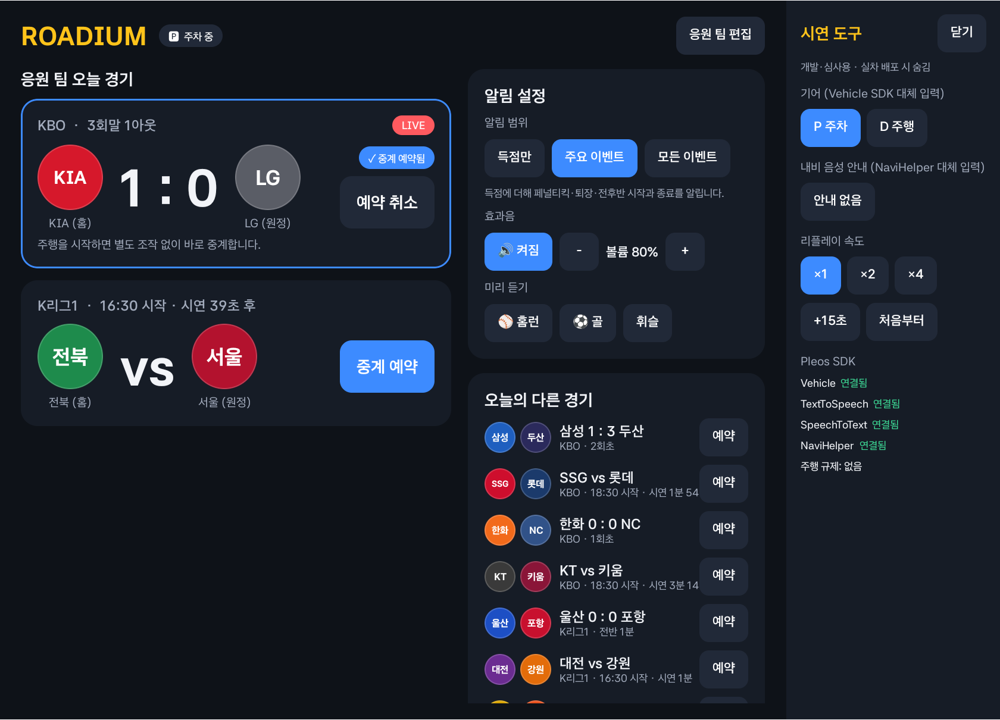
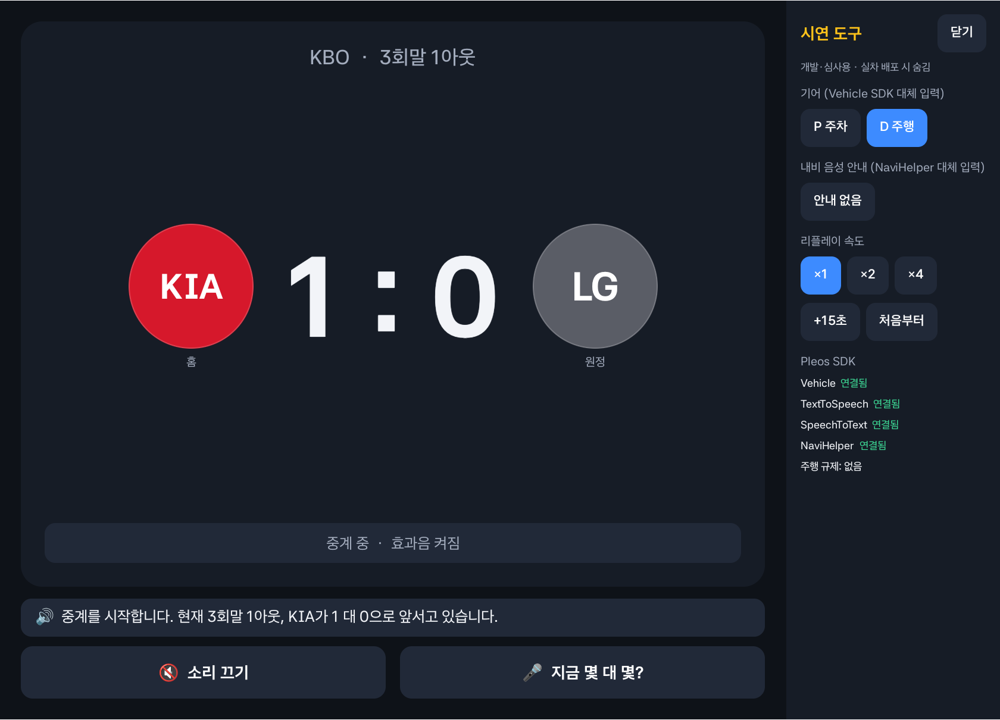
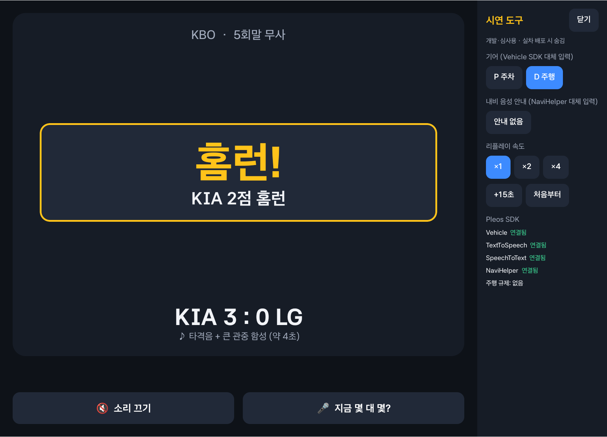
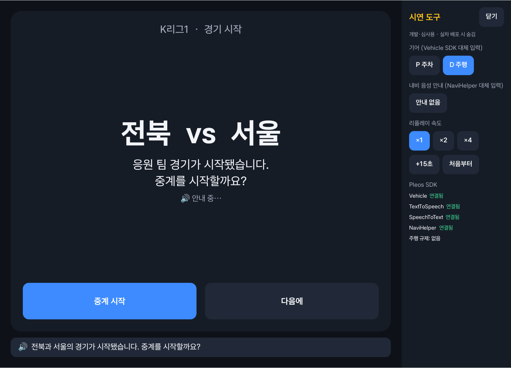
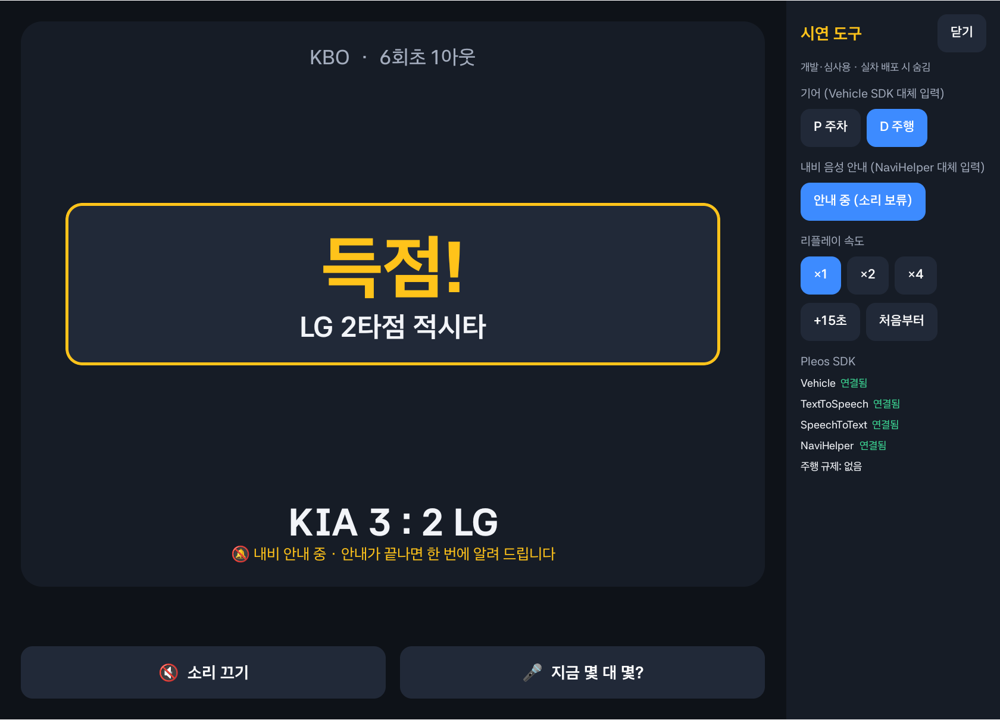
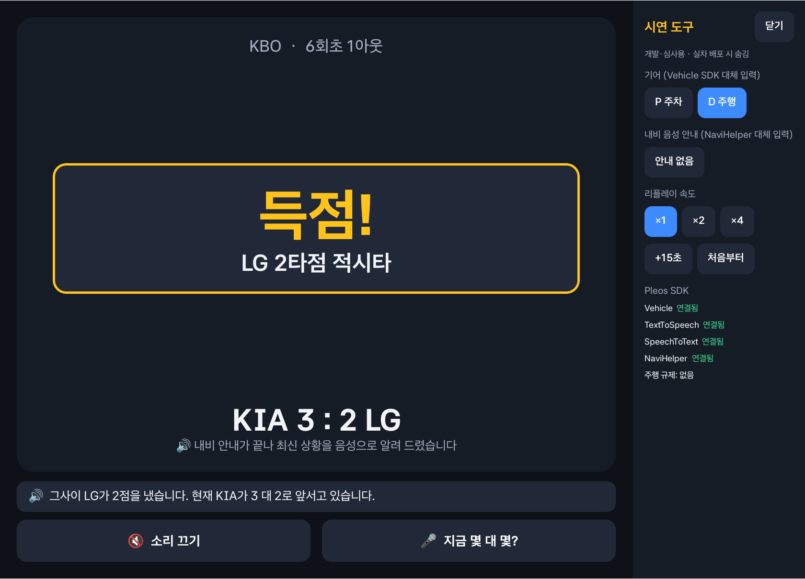
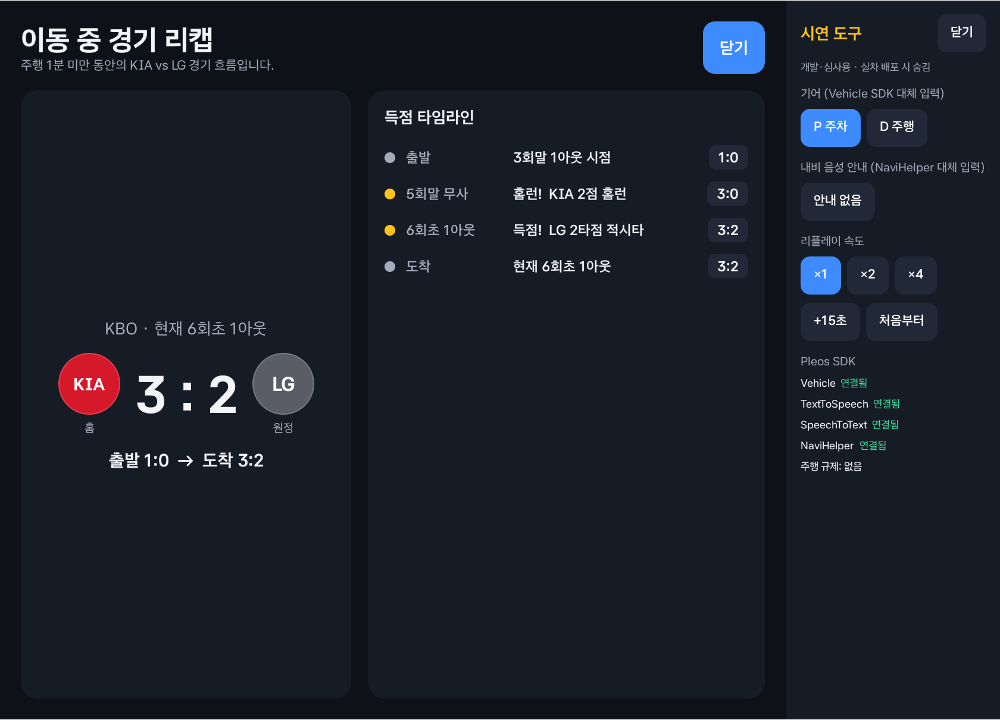
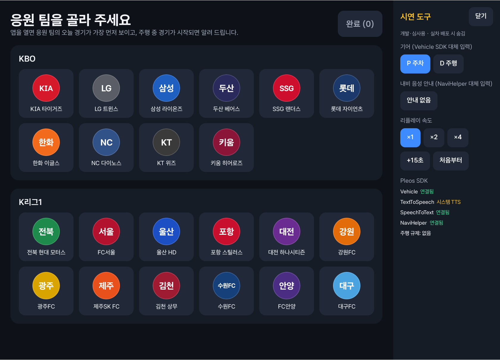

# ROADIUM (로디움)

> **한 줄 소개**: 운전 중에는 확인하기 어려운 응원 팀의 홈런·골 같은 결정적 순간을, 한눈에 읽히는 간결한 화면과 경기장 소리로 전해 주는 Pleos Connect 차량용 실시간 스포츠 이벤트 중계 앱입니다.

- **앱 이름**: ROADIUM (로디움) = Road(도로) + Stadium(경기장). "달리는 차 안이 경기장이 된다"는 뜻입니다.
- **팀**: JnR
- **구분**: 현대자동차그룹 차량용 앱 개발 공모전 출품작의 **MVP**입니다. 기획서의 핵심 흐름(응원 팀 등록 → 중계 예약 → 주행 중 스코어보드·이벤트 카드·효과음 → 내비 안내 우선 → 주차 후 리캡)을 Pleos Connect SDK 4종으로 구현했습니다.

| 주차 중 홈 (응원 팀 경기·중계 예약) | 주행 중 스코어보드 |
|---|---|
|  |  |
| **이벤트 카드 + 효과음** | **주행 중 경기 시작 알림** |
|  |  |
| **내비 안내 중: 카드만, 소리 보류** | **안내가 끝나면 한 번에 요약** |
|  |  |
| **주차 후 경기 리캡** | **응원 팀 등록** |
|  |  |

## APK

| 항목 | 내용 |
|---|---|
| 파일 위치 | [`apk/JnR_ROADIUM_release.apk`](apk/JnR_ROADIUM_release.apk) |
| 빌드 | release, 디버그 키로 서명(설치·심사용). 버전 `0.1.0-mvp` |
| 패키지 이름 | `com.jnr.roadium` |
| 지원 버전 | Android 9(API 28) 이상, Android Automotive 기기 |

## 테스트 환경 및 필요한 설정

### 테스트 환경

| 항목 | 내용 |
|---|---|
| 에뮬레이터 | **Pleos Connect Emulator v2.1.0** (AVD `Pleos_Connect_v2.1.0`, Android 14 / API 34, arm64-v8a) |
| 화면 규격 | **2560 × 1440 px, 160 dpi** (가로). 앱은 런처 오른쪽 영역, 약 **1682 × 1210 px**에 표시됩니다. 세로 화면에서도 레이아웃이 바뀌어 동작합니다. |
| 개발 PC | macOS (Apple Silicon) |
| Pleos SDK | `ai.pleos.playground:Vehicle:2.3.2`, `TextToSpeech:3.3.1`, `SpeechToText:3.3.1`, `NaviHelper:3.0.5` |
| 빌드 도구 | Android Studio, AGP 9.4.1, Gradle 9.6, Kotlin(Compose 플러그인 2.2.10), Jetpack Compose (Material 3) |
| SDK 버전 | minSdk 28, targetSdk/compileSdk 37 |

### 필요한 설정

- **권한**: `adb install -g`로 설치하면 모두 미리 허용됩니다. `-g` 없이 설치하면 첫 실행 때 허용 창이 뜹니다.
  - `pleos.car.permission.CAR_DRIVE`: 기어 조회 (Vehicle SDK)
  - `pleos.car.permission.TTS_SERVICE`, `pleos.car.permission.STT_SERVICE`: 음성 안내·음성 응답
  - `pleos.car.permission.NAVI_ROUTE`: 내비 경로·다음 안내 지점 조회 (NaviHelper, 조회만 사용)
  - `POST_NOTIFICATIONS`: 중계 예약·중계 중에 표시되는 알림
- **소리**: 효과음과 음성 안내를 들으려면 PC 스피커가 켜져 있고 에뮬레이터 미디어 볼륨이 0이 아니어야 합니다. 음성 응답("응/아니")을 쓰려면 에뮬레이터 설정에서 호스트 마이크 입력을 켭니다.
- **Virtual Console** (실제 Vehicle SDK 경로로 기어를 바꿀 때만): `adb forward tcp:8088 tcp:8088` 후 브라우저에서 `http://127.0.0.1:8088/`을 엽니다.
- **소스에서 빌드할 때만**:
  - Pleos SDK 저장소(`https://nexus-playground.pleos.ai/repository/maven-releases/`)에 접속할 수 있어야 합니다(`settings.gradle.kts`에 설정되어 있음).
  - Gradle 실행에는 JDK 17 이상이 필요합니다. 빌드용 JDK 25는 Gradle이 자동으로 내려받습니다(`gradle/gradle-daemon-jvm.properties`).
  - `local.properties`의 `sdk.dir`가 Android SDK 경로를 가리켜야 합니다(Android Studio가 자동으로 만듦).

## 실행 방법

### 1. 설치

Pleos Connect 에뮬레이터(v2.1.0)를 Cold boot로 실행한 뒤 둘 중 하나로 설치합니다.

- **A. 제출한 APK로 설치 (빌드 필요 없음)**
  ```bash
  adb install -r -g apk/JnR_ROADIUM_release.apk
  ```
- **B. 소스에서 빌드해 설치**
  ```bash
  ./gradlew :app:assembleRelease
  adb install -r -g app/build/outputs/apk/release/app-release.apk
  ```

### 2. 시연 순서 (약 3분)

앱 오른쪽의 **시연 도구** 패널로 기어(P/D)와 내비 안내 상태를 바꾸고, `+15초`로 리플레이를 앞으로 넘길 수 있습니다. 패널 아래쪽에서 Pleos SDK 4종의 연결 상태를 볼 수 있습니다.

**시나리오 A: 평일 퇴근길 야구 팬 (중계 예약)**

1. 첫 화면에서 응원 팀으로 **KIA 타이거즈**와 **전북 현대 모터스**를 고르고 `완료`를 누릅니다.
2. 홈의 KIA vs LG 카드(3회말 KIA 1:0 진행 중)에서 **`중계 예약`**을 누릅니다.
3. 시연 도구에서 **`D 주행`**을 누릅니다. 화면이 드라이브 스코어보드로 바뀌고, "중계를 시작합니다. 현재 3회말 1아웃, KIA가 1 대 0으로 앞서고 있습니다."라고 한 번 안내합니다.
4. `+15초`를 3번 누르고 기다리면 5회말 **홈런!** 카드와 타격음·관중 함성이 나옵니다.
5. 시연 도구의 **`내비 음성 안내`**를 켜고 `+15초`를 3번 누릅니다. LG 득점 카드는 뜨지만 소리는 보류됩니다.
6. 내비 안내를 끄면 "그사이 LG가 2점을 냈습니다. 현재 KIA가 3 대 2로 앞서고 있습니다."라고 한 번만 알립니다.
7. **`P 주차`**를 누르면 이동 중 득점 장면을 시간순으로 정리한 **리캡**이 열립니다.

**시나리오 B: 주말 나들이 축구 팬 (경기 시작 알림)**

1. 리캡을 닫고 시연 도구의 `처음부터`를 누른 뒤 **`D 주행`**을 누릅니다(예약 없음).
2. `+15초`를 3번 누르면 전북 vs 서울 경기가 시작되며 "전북과 서울의 경기가 시작됐습니다. 중계를 시작할까요?"라고 묻습니다. 이어서 음성 응답을 듣습니다.
3. **`중계 시작`**을 누르거나 "응"이라고 답합니다. 10초간 응답이 없으면 조용히 닫힙니다.
4. `+15초`를 여러 번 누르면 후반 23분 **골!** 카드와 골 함성, 경기 종료 휘슬과 "경기 종료. 전북이 1 대 0으로 승리했습니다."가 이어집니다.

- 주행 중 아무 때나 **`지금 몇 대 몇?`**을 누르면 음성으로 물어볼 수 있고, 현재 상황을 음성으로 알려 줍니다.
- 앱 화면을 닫거나 다른 앱(내비 등)으로 바꿔도 중계 예약·중계 중에는 효과음과 음성 중계가 이어집니다(뒤로 가기 = 숨김).

### 3. 테스트 실행

```bash
./gradlew :app:testDebugUnitTest
```

단위 테스트 18개를 실행합니다: 중계 판단 엔진 9개(시나리오 A·B, 내비 보류·요약, 리캡, 10초 무응답, 이벤트 몰림, 소리 끄기, 점수 질문), 리플레이 데이터 6개, 조사 처리·음성 의도·효과음 파일 검사 3개.

## 구현 범위

기획서 '프로토타입 개발 범위' 기준입니다.

| 기획서 기능 | MVP 동작 | 상태 |
|---|---|---|
| ① 관심 팀 등록 | KBO 10개·K리그1 12개 구단 중 여러 팀 선택. 응원 팀의 오늘 경기를 홈 맨 위에 표시 | ✅ |
| ② 중계 예약 (주차) | 예약한 경기가 진행 중이면 P단 해제 즉시, 시작 전이면 경기 시작 순간 자동으로 중계 | ✅ |
| ③ 경기 시작 알림 (주행) | TTS로 묻고, STT("응/아니") 또는 큰 버튼으로 응답. 10초 무응답 시 닫힘 | ✅ |
| ④ 드라이브 스코어보드 | 양 팀 배지·스코어·이닝/경기 시간·마지막 갱신 시각만 큰 글씨로. 움직이는 요소 없음 | ✅ |
| ⑤ 이벤트 카드 + 효과음 | 한 줄 카드 8초 + 2~4초 효과음(일시적 오디오 포커스, 덕킹 허용) | ✅ |
| ⑥ 운전 안내 우선 | NaviHelper로 다음 안내 지점 300m 이내면 소리·음성 보류, 끝나면 한 번에 요약 | ✅ |
| ⑦ 주차 후 리캡 | P단이 되면 이동 중 득점·역전 장면 타임라인 | ✅ |
| 알림 범위 3단계 | 득점만 / 주요 이벤트 / 모든 이벤트 | ✅ |
| 주행/주차 화면 전환 | Vehicle SDK 기어 + `CarUxRestrictions` 주행 규제 | ✅ |
| 예외: 이벤트 몰림 | 효과음 최소 간격 4초, 밀린 이벤트는 가장 중요한 하나만 재생, 중요한 카드는 덮지 않음 | ✅ |
| "지금 몇 대 몇이야?" | 음성 질문(STT) → 현재 상황 음성 안내(TTS) | ✅ |
| 중계 서버 | 앱 안의 리플레이 엔진이 같은 공통 이벤트 형식으로 대신함 (아래 참고) | ⚠️ 모의 |
| 통신 끊김·우천 취소 처리 | 마지막 갱신 시각 표시만 구현 | ⏳ 이후 |

**모의로 처리한 것 (실제 연동 아님)**

- **경기 데이터**: 실제 경기 흐름을 본떠 자체 제작한 **리플레이 데이터**입니다(`feed/ReplayScripts.kt`). 시연을 위해 시간을 압축했습니다(KBO 약 6분, K리그 약 3분). 오늘 경기는 KIA-LG·전북-서울 두 경기를 직접 만들었고, 나머지는 모든 구단이 한 경기씩 갖도록 고정 시드로 생성했습니다. 공식 피드와 같은 공통 이벤트 형식(`model/Game.kt`의 `GameEvent`)을 쓰므로, 제휴 후에는 `ReplayEngine` 자리만 서버 연결로 바꾸면 됩니다.
- **시연 도구 패널**: Virtual Console 없이 기어·내비 안내 상태를 바꾸는 개발자 도구입니다. 실제 Vehicle SDK·NaviHelper 신호도 동시에 받습니다. 실차 배포 시에는 숨깁니다. 시연 도구로 기어를 바꾸면 앱 상태만 바뀌고 왼쪽 클러스터의 기어 표시는 그대로입니다.
- **구단 배지**: 리그·구단 로고 대신 구단 색 원형 배지와 짧은 이름을 씁니다(기획서 시안과 동일).

**범위 밖 (기획서 '제외')**: 중계 영상·음성 재생, 여러 경기 동시 중계, 팬 채팅, 생성형 AI 해설. 음성 안내는 정해진 문장 틀만 씁니다(`engine/Phrases.kt`).

## Pleos Connect SDK 사용

| SDK / API | ROADIUM에서의 구현 | 파일 |
|---|---|---|
| **Vehicle SDK** `Gear` | `registerGearSelection`으로 기어를 구독합니다. P단에서 벗어나면 드라이브 화면과 예약 중계를 시작하고, P단이면 리캡을 엽니다. | `vehicle/PleosVehicleSource.kt` |
| **CarUxRestrictions** (AAOS) | `distractionOptimized` 선언. 규제(`NO_SETUP`/`NO_KEYBOARD`/`LIMIT_CONTENT`) 중에는 팀 등록·일정·설정 화면을 잠급니다. | `vehicle/DrivingRestrictions.kt` |
| **TextToSpeech SDK** | `ON_DEVICE` 모드, `ko-KR`. 주행 시작 시 현재 상황, 경기 시작 질문, 보류 후 요약, 경기 종료를 안내합니다. 실패하면 Android 표준 TTS로 바꾸고, 그것도 없으면 화면 자막만 표시합니다. | `voice/Announcer.kt` |
| **SpeechToText SDK** | `ON_DEVICE` 모드, `ko-KR`. 질문 안내가 끝나면 "응/아니"를 듣고, `지금 몇 대 몇?` 버튼으로 질문을 받습니다. 텍스트는 `VoiceIntents`가 의도로 바꿉니다. | `voice/VoiceInput.kt` |
| **NaviHelper SDK** | `onNavigationStatus`, `onRouteStateInfo`로 경로 안내 여부를, `onTBTInfo`·`getTBTInfo()`로 다음 안내 지점 거리를 받습니다. 300m 이내면 소리를 미룹니다. 경로 안내 중에만 2초마다 갱신합니다. | `navi/NaviGuidanceSource.kt` |
| **오디오 포커스** | 효과음마다 `AUDIOFOCUS_GAIN_TRANSIENT_MAY_DUCK`를 요청해 음악은 잠시 줄어들기만 하고, 재생이 끝나면 바로 반환합니다. 포커스를 잃으면 즉시 멈춥니다. 효과음과 음성이 겹치지 않도록 음성은 효과음이 끝난 뒤 재생합니다. | `audio/SoundPlayer.kt` |

- HYBRID/SERVER 모드 TTS·STT는 Pleos Playground My Project의 앱 등록(`registerApp`) 자격 증명이 필요합니다. 자격 증명을 받으면 `Announcer.PLEOS_MODE`만 바꾸면 됩니다.
- Pleos '미사용 앱 BG→CCH 전환 가이드'를 따릅니다. 부팅 때 자동으로 시작하지 않고, 중계 예약·중계 중에만 포그라운드 서비스(`service/BroadcastService.kt`)를 유지합니다. 예약·중계가 없으면 화면을 내릴 때 SDK와 타이머를 모두 해제합니다.

## 주행 안전 설계

- 주행 중 화면에는 영상·애니메이션·자동 스크롤이 없습니다. 이벤트 카드는 움직임 없이 화면만 바꿉니다.
- 주행 중 터치 대상은 `중계 시작/다음에`, `소리 끄기`, `지금 몇 대 몇?` 큰 버튼(높이 88~120dp)뿐입니다. 음성 자막 자리는 늘 비워 두어, 자막이 나타나도 버튼 위치가 움직이지 않습니다.
- 핵심 문구는 큰 글씨(스코어 190sp, 카드 120sp)와 높은 대비의 어두운 테마로 표시합니다.
- 내비게이션 안내가 항상 먼저입니다. 안내 구간에는 효과음과 음성을 미루고, 질문도 화면 버튼으로만 띄웁니다.

## 효과음

모든 효과음은 코드로 합성한 **자체 제작 음원**입니다(`tools/generate_sounds.py`, Python 표준 라이브러리만 사용). 중계방송의 영상·음성은 쓰지 않습니다.

| 파일 | 소리 | 쓰는 이벤트 |
|---|---|---|
| `sfx_homerun` (4.0s) | 타격음 + 큰 관중 함성 | 홈런, 역전 득점 |
| `sfx_score` (3.0s) | 타격음 + 관중 함성 | 득점 |
| `sfx_hit` (1.6s) | 타격음 | 안타 |
| `sfx_mitt` (0.9s) | 포수 미트 | 삼진, 이닝 종료 |
| `sfx_siren` (3.0s) | 경기 종료 사이렌 | 야구 경기 종료 |
| `sfx_goal` (4.0s) | 골 함성 | 골 |
| `sfx_whistle_short` / `_half` / `_end` | 주심 휘슬 1·2·3번 | 페널티킥·퇴장 / 전후반 / 경기 종료 |

- 음원 기준: 4초 이내, 앞에 60ms 선행 묵음(첫소리 잘림 방지), 끝 페이드아웃, 22.05kHz 16bit 모노 WAV.
- 다시 만들기: `python3 tools/generate_sounds.py`

## 구조

```
경기 데이터                 중계 판단 엔진                  출력
ReplayEngine ─GameEvent─▶  BroadcastEngine ─Effect─▶  화면(카드·스코어보드·질문·리캡)
(리플레이, 공통 형식)        ▲  ▲  ▲                      효과음(SoundPlayer, 오디오 포커스)
                           │  │  └ 알림 범위·소리 설정       음성(Announcer: Pleos TTS)
Vehicle SDK (기어) ────────┘  │
NaviHelper (안내 구간) ───────┘   SpeechToText(응/아니·점수 질문) → VoiceIntents → 엔진
```

| 파일 | 역할 |
|---|---|
| `feed/ReplayEngine.kt`, `feed/ReplayScripts.kt` | 리플레이 중계 서버 역할. 시연 시간에 맞춰 공통 이벤트를 만들고 카드 문구를 정해진 틀로 채웁니다. |
| `engine/BroadcastEngine.kt` | 순수 Kotlin. 예약·자동 시작·경기 시작 질문·알림 범위·내비 보류와 요약·이벤트 몰림·리캡을 판단합니다. |
| `engine/Phrases.kt`, `engine/Korean.kt` | 음성 안내 문장 틀과 조사 처리(KIA**가** / 전북**이**, 1 대 0**으로** / 3 대 2**로**). |
| `RoadiumController.kt` | 피드·엔진·SDK·화면 상태를 잇는 연결부. |
| `ui/` | `ParkedHome`(주차), `DriveScreen`(주행), `TeamSelectScreen`, `RecapScreen`, `SimulatorPanel`(시연 도구). |

## 알려진 제약

- **경기 데이터는 모의 데이터**입니다. 정식 서비스에서는 스포츠투아이(KBO)·한국프로축구연맹 Open API(K리그) 제휴 피드를 중계 서버에서 같은 형식으로 변환해 내려받습니다(기획서 5장).
- **음성 응답**은 에뮬레이터에서 호스트 마이크를 켜야 동작합니다. 인식이 되지 않아도 큰 버튼으로 같은 조작을 할 수 있습니다.
- **release 빌드**는 시연용으로 디버그 키로 서명했습니다. R8 코드 최적화는 Pleos SDK와 충돌(`IllegalAccessError`)해서 껐습니다.
- **시연 도구 패널**은 개발·심사용입니다. 실차 배포 시에는 숨깁니다.
